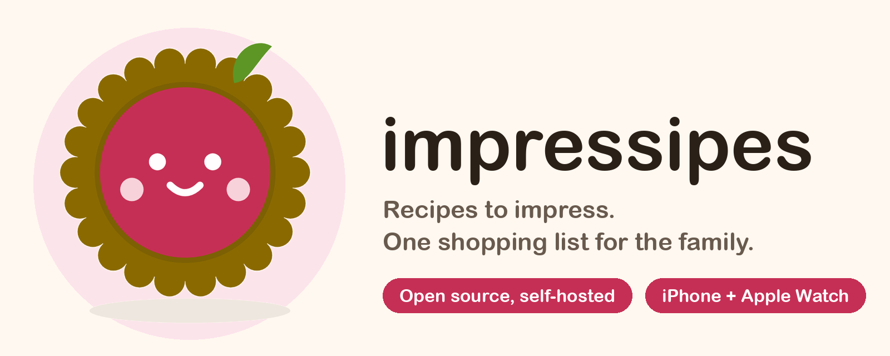

<p align="center">
  
</p>

# Impressipes

A small, self-hosted recipe book and shared shopping list for a household. You run the server; everyone you invite signs in to the same recipes and the same lists, and changes show up live on every device.

- **Recipes**: write them on the web, with photos, tags, servings scaling, favourites and "want to make".
- **Shopping lists**: quick-add ("2 cans chickpeas"), tick items off in the shop, add a recipe's ingredients to a list.
- **Live and offline-tolerant**: lists sync across members in real time; check-offs made without signal are queued and sent later.
- **Invite-only**: nobody joins without an invite from an admin. Sign in with email and password, an emailed link, passkeys, or Sign in with Apple.
- **AI-friendly**: an MCP server at `/mcp` lets Claude and other assistants read recipes and edit lists ([docs/mcp.md](docs/mcp.md)).

## Platforms

Impressipes is **Apple-only for now**. The server and web app work in any browser, but the native apps are built for Apple devices:

| Client | Status |
| --- | --- |
| Web (any modern browser) | Full: recipe authoring, lists, admin and invites |
| iPhone (iOS 18+) | Browse recipes, run lists, passkeys, Sign in with Apple |
| Apple Watch | Cross items off a list, even out of range of the phone |
| Android, Windows, Linux apps | Not planned yet |

There is no App Store build. To use the iPhone and Watch apps, build them yourself in Xcode with your own Apple Developer account (see [apps/ios/README.md](apps/ios/README.md)).

## Deploy to your own Coolify

The repo's root `Dockerfile` builds the web app and the Go API into one small container serving everything on port 8080. You need a [Coolify](https://coolify.io) instance, a domain pointed at it, and a Postgres database.

1. **Create a Postgres database.** In your Coolify project, add a new resource: **PostgreSQL 17**. Start it and copy its **Postgres URL (internal)**.
2. **Create the application.** Add a new resource from a public (or your fork's) Git repository: `https://github.com/brianbancroft/impressipes`, branch `main`, build pack **Dockerfile**, port **8080**, and set your domain.
3. **Turn the health check off.** The image has no shell or curl, so Coolify's in-container check would always fail. (`GET /healthz` is there for external monitors.)
4. **Add a persistent volume** at `/data` (Storages → Add → destination path `/data`). Recipe photos live there; without it they vanish on every deploy.
5. **Set environment variables:**

   | Variable | Value |
   | --- | --- |
   | `DATABASE_URL` | The internal Postgres URL from step 1. Required; the schema migrates itself on boot. |
   | `APP_URL` | Your public origin, e.g. `https://recipes.example.com`. Emailed links and passkeys depend on it. |
   | `RESEND_API_KEY` | A [Resend](https://resend.com) API key, for sign-in and invite email. |
   | `MAIL_FROM` | Sender on a domain verified in Resend, e.g. `Impressipes <noreply@example.com>`. |

   Without a mail sender the API only logs links and codes, which is fine for a first look but not for real use.
6. **Deploy**, then open the deployment log. On first run it prints `first run: open /invite/...`. Open that link to create the admin account, then invite everyone else from the web app.

Redeploys are manual by default. [docs/deploy.md](docs/deploy.md) covers a one-command deploy (`mise run deploy`) with a Coolify API token, plus every setting in detail.

### Optional: Apple ID (passkeys, Sign in with Apple, iOS app)

Skip this if you only use the web app with email sign-in. To let the iPhone app use passkeys and Sign in with Apple, you need a paid [Apple Developer](https://developer.apple.com) account.

1. In the Developer portal, enable **Sign in with Apple** and **Associated Domains** on your App ID. Change the bundle ID prefix in `apps/ios/project.yml` to your own and set `DEVELOPMENT_TEAM` to your team.
2. Set `APPLE_TEAM_ID` on the Coolify app to your 10-character Team ID. This serves `/.well-known/apple-app-site-association`, which the iOS app needs for passkeys and for opening emailed links.
3. *For the "Sign in with Apple" button on the web only:* create a **Services ID**, register your domain and return URL (`APP_URL`) on it, and set `APPLE_WEB_CLIENT_ID` to it.
4. Build the iOS app in Xcode, launch it, and enter your server's URL on first launch.

Passkeys are bound to your domain, so decide on `APP_URL` before members register any; changing it orphans them. A member links their Apple ID from Account (web) or Settings → Sign-in & security (iOS).

## Development

An [Nx](https://nx.dev) monorepo: `apps/web` (Vite + React), `apps/api` (Go, Postgres), `apps/ios` (SwiftUI, iPhone and Watch) and `libs/api-spec` (the OpenAPI contract and generated clients). Tool versions come from [mise](https://mise.jdx.dev).

```bash
mise install
mise run install
mise run up       # Postgres (Docker), Mailpit, API and SPA, seeded; web on :4200
```

Local sign-in email lands in Mailpit at http://localhost:8025. Other tasks: `mise run dev|stop|down|reset|build|test|lint`. Every task is listed in [mise.toml](mise.toml).

## More docs

[Deploying](docs/deploy.md) · [MCP server](docs/mcp.md) · [iOS app](apps/ios/README.md) · [Codegen and database](docs/codegen-and-db.md) · [Information architecture](docs/information-architecture.md)

## License

[MIT](LICENSE)
